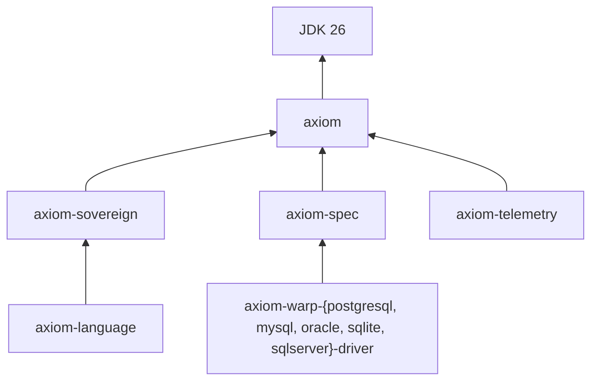

<p align="center">
  
</p>

<h1 align="center">Ensemblu · Project Axiom 3.0</h1>

<p align="center">
  <strong>Java, without the middlemen.</strong><br/>
  <em>Immutable, data-oriented infrastructure for Java 26: native database drivers, zero reflection, zero third-party dependencies.</em>
</p>

<p align="center">
  
  
  
  
  
  
</p>

<p align="center">
  🌐 <a href="https://ensemblu-corp.github.io/assets/index.html"><strong>Homepage</strong></a> ·
  📦 <a href="https://central.sonatype.com/namespace/com.ensemblu"><strong>Maven Central</strong></a> ·
  📖 <a href="https://www.javadoc.io/doc/com.ensemblu"><strong>Javadocs</strong></a> ·
  📚 <a href="https://github.com/ensemblu-corp/assets/tree/main/blogs"><strong>Articles</strong></a> ·
  💖 <a href="https://github.com/sponsors/ensemblu"><strong>Sponsor</strong></a>
</p>

---

## ✨ What's new in 3.0

| | |
|---|---|
| ⚡ **Native drivers through Project Panama** | PostgreSQL, MySQL, Oracle, SQLite and SQL Server, reached through the vendor's own C client. No JDBC, no connection pool. |
| 🧠 **Off-heap parsing** | `JsonParser`, `CsvRowParser`, `AxiomDopParser` and `SchemaGuard` read a `MemorySegment` directly, including memory-mapped files. |
| 🛰️ **`axiom-telemetry`** | A lock-free black-box flight recorder that attaches pre-failure context to any failed `Result`. |
| 📜 **Contract-verified bulk ingest** | CSV headers and declared types are checked against the live catalog before a single row moves. |
| 🧩 **Ten modules, one version** | Five core modules and five drivers, released together, signed, with sources and Javadoc. |

➡️ Full details: **[Axiom 2.0.0 → 3.0.0 — Ultimate Release Changelog](https://github.com/ensemblu-corp/assets/blob/main/blogs/changelog-2.0.0-to-3.0.0.md)**

---

## ⚙️ Quickstart

```xml
<dependency>
    <groupId>com.ensemblu</groupId>
    <artifactId>axiom-warp-postgresql-driver</artifactId>
    <version>3.0.0</version>
</dependency>
```

```java
var pg = PostgreSQL.connect(Axiom.Config.file("database.properties"))
        .requiredHost().requiredPort().requiredDbName().requiredUser()
        .optionalPassword()
        .getPostgreSqlDriverOrThrow();

Result<PersistentList<PersistentMap<String, Object>>> rows = pg.wield(conn -> pg
        .dynamicQuery("SELECT * FROM accounts WHERE status = :java.status LIMIT :java.limit")
        .to("ACTIVE").bind(PostgresType.TEXT)
        .to(10).bind(PostgresType.INT8)
        .execute(conn));        // native connection closed, arena freed, failures stay values
```

```bash
java --enable-preview --enable-native-access=ALL-UNNAMED -jar app.jar
```

---

## 📦 Published packages (`com.ensemblu` · `3.0.0`)

### Core

| Package | Description | Depends on |
|---|---|---|
| **[axiom](https://github.com/ensemblu-corp/axiom)** | The zero-dependency foundation: persistent vector tries and HAMT maps, `Result`, `If` / soft validation / `Guard`, `Source` navigation, typed extraction, `ConfigSource`, `Dop`, explicit `Effect`s. | JDK only |
| **[axiom-sovereign](https://github.com/ensemblu-corp/axiom-sovereign)** | The sovereign assembly line: a single-pass, off-heap parser for DOP (`.axiom`) notation. | `axiom` |
| **[axiom-language](https://github.com/ensemblu-corp/axiom-language)** | Perimeter validation with `SchemaGuard` and `MasterGuard`: cached `.axiom` schemas checking structure, then type, then constraints. | `axiom-sovereign` |
| **[axiom-spec](https://github.com/ensemblu-corp/axiom-spec)** | The shared wire contract: `JsonParser`, `CsvRowParser`, `JsonEmitter`, all `MemorySegment`-native. | `axiom` |
| **[axiom-telemetry](https://github.com/ensemblu-corp/axiom-telemetry)** 🆕 | The black-box flight recorder: `TemporalStreamBuffer` + `SovereignExecution`. | `axiom` |

### Native drivers 🆕

| Package | Native client | Binding | Bulk ingest |
|---|---|---|---|
| **[axiom-warp-postgresql-driver](https://github.com/ensemblu-corp/axiom-warp-postgresql-driver)** | `libpq` | `$n` via `PQexecParams` + explicit OID | `COPY … FROM STDIN` |
| **[axiom-warp-mysql-driver](https://github.com/ensemblu-corp/axiom-warp-mysql-driver)** | `libmysqlclient` | escaped literal splice (`bindQuotedValue`) | batched multi-row `INSERT` |
| **[axiom-warp-oracle-driver](https://github.com/ensemblu-corp/axiom-warp-oracle-driver)** | OCI (Instant Client) | `:n` via `OCIBindByPos` | prepared `INSERT`, bind-once buffers |
| **[axiom-warp-sqlite-driver](https://github.com/ensemblu-corp/axiom-warp-sqlite-driver)** | `sqlite3` | `sqlite3_bind_*` | prepare once, `step` / `reset` per row |
| **[axiom-warp-sqlserver-driver](https://github.com/ensemblu-corp/axiom-warp-sqlserver-driver)** | ODBC + MS ODBC Driver 18 | `SQLBindParameter` | prepared `INSERT`, bind-once buffers |

Every driver exposes the same `Executioner`: `wield`, `transaction`, `wieldTransactional`, `shot`, `dynamicQuery` and `fromFile`.



> **Retired in 3.0:** `axiom-warp-jdbc` and `axiom-warp-reactive`. The 2.0.0 artifacts remain on Maven Central. See the [migration guide](https://github.com/ensemblu-corp/assets/blob/main/blogs/changelog-2.0.0-to-3.0.0.md#8-migration-guide).

---

## 🎯 Reference demonstration

### [axiom-strike-jdbc](https://github.com/ensemblu-corp/axiom-strike-jdbc) → `axiom-strike-postgresql` 3.0

The flagship reference implementation, rewritten for 3.0. It's a bare `HttpServer` with `SchemaGuard`-validated endpoints for parameterised reads, all-or-nothing batch writes and parallel reads on virtual threads, plus a transactional schema bootstrap and contract-verified CSV seeding, all against PostgreSQL through `libpq`. It has no Spring, no ORM, no JDBC, no pool, and **zero third-party dependencies**.

---

## 📚 Technical articles & architecture notes

<p align="center">📚 <strong><a href="https://github.com/ensemblu-corp/assets/tree/main/blogs">Browse all articles</a></strong></p>

### Axiom 3.0

- **[Axiom 2.0.0 → 3.0.0: Ultimate Release Changelog](https://github.com/ensemblu-corp/assets/blob/main/blogs/changelog-2.0.0-to-3.0.0.md)**: every breaking change, the new dependency graph, a 10-step migration and a checklist.
- **[Why Axiom 3 Talks to Databases Natively](https://github.com/ensemblu-corp/assets/blob/main/blogs/axiom-3-native-drivers.md)**: Project Panama, five vendor clients, one `Executioner` shape, and the honest trade-offs of no-pool connections.
- **[A Black Box for Every Result: axiom-telemetry](https://github.com/ensemblu-corp/assets/blob/main/blogs/axiom-telemetry-flight-recorder.md)**: how a lock-free, time-windowed buffer turns "it failed" into "here's what happened before it failed".

### Philosophy

- **[Hard Truths About Java Persistence](https://github.com/ensemblu-corp/assets/blob/main/blogs/axiom-persistence-hard-truths.md)**: eight statements about ORMs, dynamic queries and SQL fluency.

### Axiom 2.x archive

- **[Axiom vs. the Java Persistence Landscape](https://github.com/ensemblu-corp/assets/blob/main/blogs/axiom-vs-java-persistence-landscape.md)**: Hibernate, EclipseLink, Spring Data, jOOQ, Querydsl, MyBatis, Spring JDBC and JDBI.
- **[Axiom Type Bridging Guide](https://github.com/ensemblu-corp/assets/blob/main/blogs/axiom-type-bridging-guide.md)**: the 2.x `AxiomProtocol` + `::cast` model.
- **[Axiom 1.0.0 → 2.0.0 Changelog](https://github.com/ensemblu-corp/assets/blob/main/blogs/changelog-1.0.0-to-2.0.0.md)**: `String` → `byte[]` parsers and `JsonEmitter`.

---

## ⚖️ License

Axiom is published under the **Limited Commercial License**. It's free for evaluation, testing, education and non-commercial development. Production or commercial use requires a paid annual Commercial Enterprise License Agreement.

📩 **[contact@ensemblu.com](mailto:contact@ensemblu.com)** · 🏢 [Enterprise services](https://ensemblu-corp.github.io/assets/services.html)

<p align="center"><sub>© Ensemblu Corp · Built with nothing but the JDK.</sub></p>
